<div align="center">

# 🏥 Multimodal Clinical Decision Support System (CDSS)
### An Agentic Clinical Decision Support Platform Powered by Multimodal Deep Learning, Hybrid RAG, and Explainable AI (XAI)

<p align="center">
  <b>Undergraduate Capstone / Thesis Project</b><br>
  <i>Medical Imaging • Numerical Laboratory Reports • Clinical Anamnesis • Evidence-Based Literature Retrieval • Explainable AI (XAI)</i>
</p>

<p align="center">
  <a href="README.md"><b>🇹🇷 Türkçe</b></a> •
  <a href="README.en.md"><b>🇬🇧 English</b></a>
</p>

---

<!-- Badges -->


</div>

---

## 📌 Table of Contents
- [Project Overview & Academic Motivation](#-project-overview--academic-motivation)
- [System Architecture & Distributed Services](#-system-architecture--distributed-services)
- [Python AI Service & LangGraph Agentic Pipeline](#-python-ai-service--langgraph-agentic-pipeline)
  - [LangGraph Workflow Diagram](#langgraph-workflow-diagram)
  - [Dual-Stream Hybrid RAG Architecture](#dual-stream-hybrid-rag-architecture)
  - [Self-Critique & Conflict Resolver Loop](#self-critique--conflict-resolver-loop)
- [Deep Learning & Machine Learning Models](#-deep-learning--machine-learning-models)
  - [CDSS Modality Router (ResNet-18)](#1-cdss-modality-router-resnet-18)
  - [Hierarchical Chest X-Ray Models (DenseNet-121)](#2-hierarchical-chest-x-ray-models-densenet-121)
  - [Brain MRI and Ophthalmology Models (ResNet-50)](#3-brain-mri-and-ophthalmology-models-resnet-50)
  - [Laboratory Diagnostic Models (XGBoost)](#4-laboratory-diagnostic-models-xgboost)
- [Explainable AI (XAI)](#-explainable-ai-xai)
- [Core-Backend Architecture (Spring Boot & PostgreSQL)](#-core-backend-architecture-spring-boot--postgresql)
- [Frontend Architecture (React 19 & Tailwind CSS v4)](#-frontend-architecture-react-19--tailwind-css-v4)
- [Setup & Execution Guide](#-setup--execution-guide)
- [Engineering Insights & Future Work](#-engineering-insights--future-work)
- [Author & License](#-author--license)

---

## 🔬 Project Overview & Academic Motivation

In clinical practice, a diagnosis is never made based on isolated data. A physician reviews the patient's medical history and symptoms, inspects biochemical blood and urine panels, evaluates radiological scans, and synthesizes these findings against international clinical guidelines.

Most contemporary medical AI applications either rely on **unimodal standalone models** (e.g., standard image classification) or suffer from **black-box LLM limitations** with weak medical verifiability. The primary vulnerabilities include:
1. **Hallucination Risk:** Unconstrained LLMs generating non-standard or medically hazardous treatment recommendations.
2. **Cross-Modality Inconsistency:** The absence of a deterministic reconciliation mechanism when laboratory tests and radiological findings disagree.
3. **Lack of Explainability:** Inability to pinpoint the anatomical lesion on scans (visual evidence) or explain which biomarkers drove the diagnostic probability (numerical attribution).

This undergraduate capstone project introduces a **multimodal, verifiable Clinical Decision Support System (CDSS)** designed not to replace physicians, but to empower clinical decision-making with explainable, evidence-backed recommendations.

> [!NOTE]  
> **Core Engineering Philosophy:** The platform orchestrates **PyTorch deep learning vision models**, **XGBoost tabular classifiers**, **dual-stream hybrid literature retrieval (Pinecone Dense Vector + BM25 Sparse + BGE Cross-Encoder Reranker + Live Web Research)**, and a **LangGraph cyclical state machine**. Clinical safety is strictly reinforced through iterative **Self-Critique** and **Conflict Resolver** agent feedback loops.

---

## 🏗️ System Architecture & Distributed Services

Built according to the principle of separation of concerns, the system features a **3-tier distributed microservice architecture**:

```
┌─────────────────────────────────────────────────────────────────────────────┐
│                            FRONTEND (React 19 + Vite)                       │
│      Doctor Consultation Workspace • Multimodal Panels • Real-time Chat     │
└──────────────────────────────────────┬──────────────────────────────────────┘
                                       │ HTTP REST / JWT Bearer (Port 5173 ↔ 8080)
                                       ▼
┌─────────────────────────────────────────────────────────────────────────────┐
│                         CORE-BACKEND (Spring Boot 4 + Java 21)              │
│    Business Logic • Security & Auth • Data Integrity • PostgreSQL (JSONB)   │
└──────────────────────────────────────┬──────────────────────────────────────┘
                                       │ HTTP POST /api/agent/chat (Port 8080 ↔ 8000)
                                       ▼
┌─────────────────────────────────────────────────────────────────────────────┐
│                          PYTHON AI SERVICE (FastAPI + LangGraph)            │
│   Multimodal Perception • CNN & XGBoost • Hybrid RAG • XAI • Reasoning      │
└─────────────────────────────────────────────────────────────────────────────┘
```

### Services & Responsibilities

| Service | Technology | Port | Primary Responsibility |
|---|---|---|---|
| **Frontend** | React 19, Tailwind CSS v4, Lucide | `5173` | Doctor workspace; dynamic patient anamnesis, image & document analysis panels, interactive citation cards, RLHF feedback mechanism. |
| **Core-Backend** | Spring Boot 4.0.3, Java 21, Hibernate 6 | `8080` | Domain entities (Doctor, Patient, Consultation), Spring Security JWT auth, PostgreSQL JSONB persistence, and synchronous AI orchestration. |
| **Python AI** | FastAPI, LangGraph, PyTorch, XGBoost | `8000` | Multimodal document parsing, deep vision & tabular inference, hybrid RAG pipeline, Grad-CAM++ generation, and LangGraph state routing. |
| **Database** | PostgreSQL 15 (Docker) | `5432` | Relational tables, analysis outputs, model predictions, and structured literature citations in native JSONB format. |

---

## 🧠 Python AI Service & LangGraph Agentic Pipeline

The decision engine is formulated as a deterministic **State Machine (`StateGraph`)** using LangGraph. The pipeline dynamically routes execution depending on the inputs provided, synchronizes parallel streams, and executes self-correction loops when discrepancies are detected.

### LangGraph Workflow Diagram

The rendered topology of the compiled LangGraph state machine is shown below:

<div align="center">
  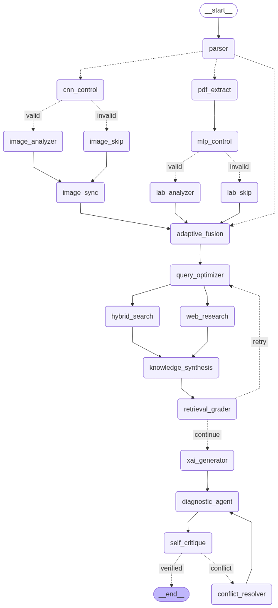
  <p><i>Figure 1: Multimodal Agentic StateGraph Topology in LangGraph</i></p>
</div>

### Step-by-Step Execution Lifecycle:

1. **Parser & Dynamic Router:** Inspects incoming patient messages, uploaded radiological images, and/or laboratory PDF reports. Skips inactive branches to minimize latency.
2. **Visual Perception Stream:**
   - **CNN Control (Gatekeeper):** Verifies medical image validity and modality (`BRAIN`, `LUNG`, `EYE`).
   - **Image Analyzer:** Dispatches the image to the corresponding specialist model (ResNet-50 or DenseNet-121).
   - **Image Sync:** Acts as a synchronization buffer to balance the superstep execution counts between the image branch and the multi-step lab branch, preventing premature invocation of `Adaptive Fusion`.
3. **Laboratory Perception Stream:**
   - **PDF Extract:** Extracts raw digital text from lab reports using PyMuPDF.
   - **MLP Control:** An LLM-backed medical sanity checker that extracts and normalizes lab biomarkers into a typed `LabReport` schema while asserting that mandatory key features exist.
   - **Lab Analyzer:** Runs the corresponding XGBoost model and filters high/low out-of-reference biomarker anomalies.
4. **Adaptive Fusion Node:** Combines multimodal findings (patient demographics, chief complaint, chronic illnesses, allergies + CNN visual findings + XGBoost model risks + out-of-bounds lab parameters) into a coherent clinical context.
5. **Dual-Stream Hybrid RAG:**
   - **Query Optimizer:** Expands clinical queries with standardized medical taxonomy.
   - **Hybrid Search & Web Research:** Queries local vector/sparse indexes and PubMed/NIH web portals in parallel.
   - **Knowledge Synthesis:** Cross-references retrieved passages and injects citation tokens (`[Ref-N]`).
   - **Retrieval Grader:** Evaluates whether retrieved evidence sufficiently answers the clinical query (*Max 2 retries*).
6. **XAI Generator & Diagnostic Agent:** Produces a **Grad-CAM++** visual heatmap and tabular **Feature Importance** rankings. The Chief Medical Officer agent synthesizes findings into a formal report.
7. **Self-Critique & Conflict Resolver:** Verifies report consistency across all modalities. In case of conflict or hallucination, it triggers the `Conflict Resolver` to instruct the diagnostic agent to revise its reasoning (*Safety capped at 2 iterations*).

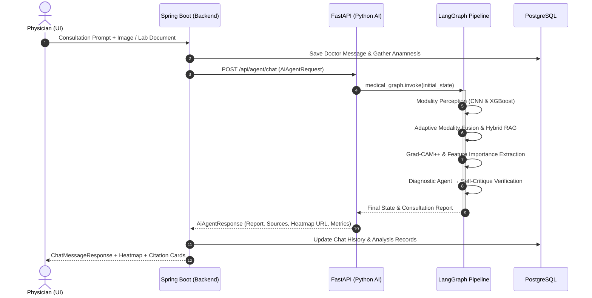

---

## 📚 Dual-Stream Hybrid RAG Architecture

Pure semantic vector search frequently overlooks dense clinical terms, acronyms, or specific drug dosages. This system implements a **Reciprocal Rank Fusion (RRF)** hybrid architecture:

```
                         ┌─────────────────────────────┐
                         │   Query Optimizer (LLM)     │
                         └──────────────┬──────────────┘
                                        │
                    ┌───────────────────┴───────────────────┐
                    ▼                                       ▼
     ┌─────────────────────────────┐         ┌─────────────────────────────┐
     │   Local Guideline Corpus    │         │   Live Medical Literature   │
     │   Pinecone Dense Vector     │         │   Tavily Search API         │
     │            +                │         │   Filters: PubMed, NIH, Mayo│
     │   BM25Okapi (Sparse)        │         └──────────────┬──────────────┘
     │            +                │                        │
     │   BGE Reranker v2-m3        │                        │
     └──────────────┬──────────────┘                        │
                    │                                       │
                    └───────────────────┬───────────────────┘
                                        ▼
                         ┌─────────────────────────────┐
                         │ Knowledge Synthesis Node    │
                         │ [Ref-1], [Ref-2] Tagging    │
                         └─────────────────────────────┘
```

- **Dense Semantic Retrieval:** Embeddings computed via `sentence-transformers/all-MiniLM-L6-v2` against Pinecone vector database.
- **Sparse Keyword Matching:** Exact match retrieval via `rank_bm25` (BM25Okapi).
- **Cross-Encoder Reranking:** Candidate passages re-scored using `BAAI/bge-reranker-v2-m3`.
- **Live Medical Web Search:** Verified evidence retrieved from PubMed, NIH, and Mayo Clinic via Tavily API.

---

## 🤖 Deep Learning & Machine Learning Models

Rather than using generic, uncalibrated vision APIs, the models in this project were trained or fine-tuned on benchmark medical datasets, with calibrated decision thresholds to prioritize clinical safety.

### 1. CDSS Modality Router (ResNet-18)
A local classifier that inspects uploaded imagery and identifies the anatomical domain:
- **Architecture:** PyTorch ResNet-18 (Transfer Learning + Dropout 0.3)
- **Classes:** `BRAIN`, `LUNG`, `EYE`, `OTHER`
- **Performance:** >96% validation accuracy across balanced classes.

<div align="center">
  <table>
    <tr>
      <td align="center"><b>Confusion Matrix</b></td>
      <td align="center"><b>Training & Validation Metrics</b></td>
    </tr>
    <tr>
      <td>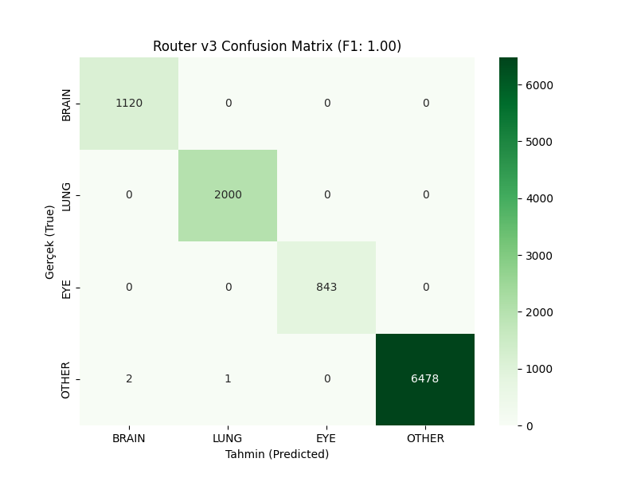</td>
      <td>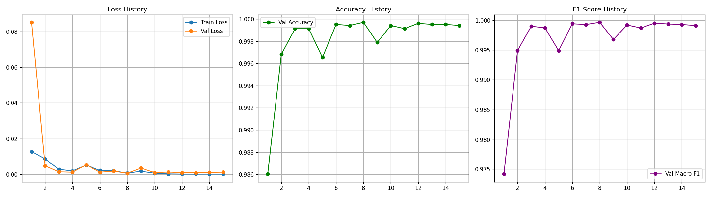</td>
    </tr>
  </table>
  <p><i>Figure 2: Performance Evaluation of the CDSS Modality Router</i></p>
</div>

---

### 2. Hierarchical Chest X-Ray Models (DenseNet-121)
To minimize False Negatives (missing pathological cases), a **two-tier architecture** is employed:

#### A) Gatekeeper (Binary Anomaly Screening)
- **Model:** DenseNet-121 (Single Logit Output)
- **Strategy:** `Max F2` and `Constrained Recall (>=0.94)` calibration.
- **Objective:** Screen incoming chest X-rays to ensure virtually no pathology is dropped.

```
=== GATEKEEPER VALIDATION RESULTS ===
Strategy: Max F2 (Recall-Weighted)
Calibrated Threshold   : 0.090190
Pathological Recall    : 98.61% (15,975 / 16,201 sick cases captured)
Pathological Precision : 73.16%
F2 Score               : 0.8399
```

#### B) Dual-Head Multi-Label DenseNet-121
Images flagged by the gatekeeper are forwarded to a multi-label DenseNet-121 model trained on **142,279 images** (using TorchXRayVision weights):
- **Head A (Stable Classes):** Effusion, Edema, Cardiomegaly
- **Head B (Noisy Classes):** Atelectasis, Consolidation, Pneumonia, Pneumothorax
- **Threshold Calibration:** Independent `Max F1` thresholding per pathology.

<div align="center">
  <table>
    <tr>
      <td align="center"><b>Gatekeeper Metrics (Epoch 17)</b></td>
      <td align="center"><b>Multi-Label Training Curves (Epoch 20)</b></td>
    </tr>
    <tr>
      <td>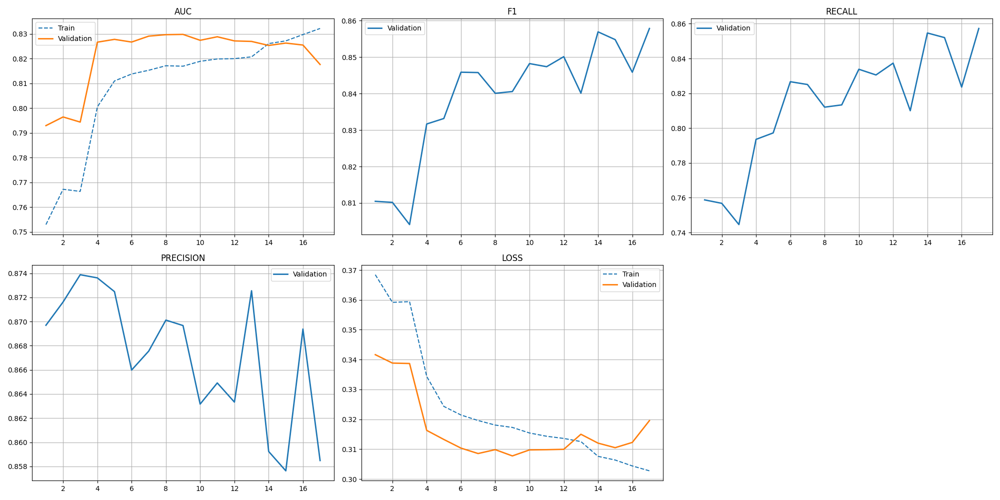</td>
      <td>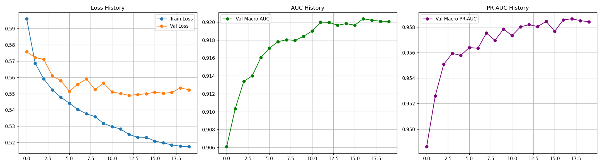</td>
    </tr>
  </table>
  <p><i>Figure 3: Training and Validation Metrics for Chest Radiography Models</i></p>
</div>

| Pathology | Optimal Threshold | F1 Score | Precision | Recall |
|---|---|---|---|---|
| **Pleural Effusion** | `0.5286` | **0.9496** | 0.9405 | 0.9588 |
| **Pulmonary Edema** | `0.6893` | **0.9132** | 0.8814 | 0.9474 |
| **Cardiomegaly** | `0.8666` | **0.9303** | 0.9202 | 0.9405 |
| **Consolidation** | `0.8941` | **0.8865** | 0.8872 | 0.8859 |

---

### 3. Brain MRI and Ophthalmology Models (ResNet-50)

- **Brain Tumor MRI Classification:**
  - **Classes:** Glioma, Meningioma, Pituitary Tumor, Normal (No Tumor).
  - **Architecture:** ResNet-50 transfer learning with custom dropout classification head.
- **Ocular Disease Screening (Fundus Imagery):**
  - **Classes:** Cataract, Diabetic Retinopathy, Glaucoma, Normal.
  - **Validation Accuracy:** **94.00%**, Diabetic Retinopathy F1: **1.00**, Cataract F1: **0.96**.

---

### 4. Laboratory Diagnostic Models (XGBoost)
Numerical biochemistry and hematology reports are parsed and evaluated using specialized XGBoost models. Each model checks for mandatory biomarkers (`MANDATORY_FEATURES`) before running inference:

<div align="center">
  <table>
    <tr>
      <td align="center"><b>Diabetes Feature Importance</b></td>
      <td align="center"><b>Cardiovascular Risk Feature Importance</b></td>
    </tr>
    <tr>
      <td>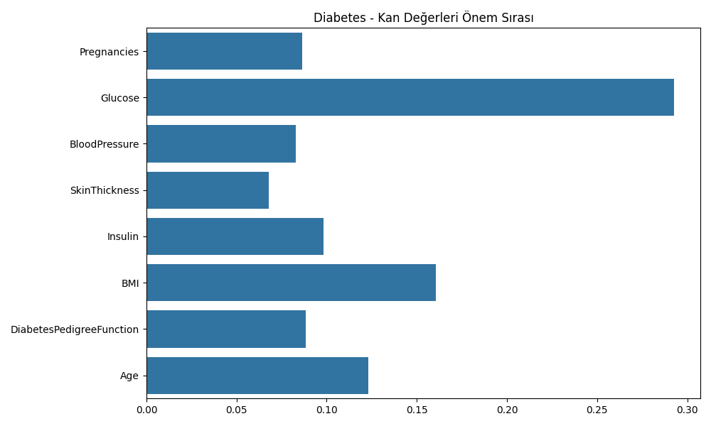</td>
      <td>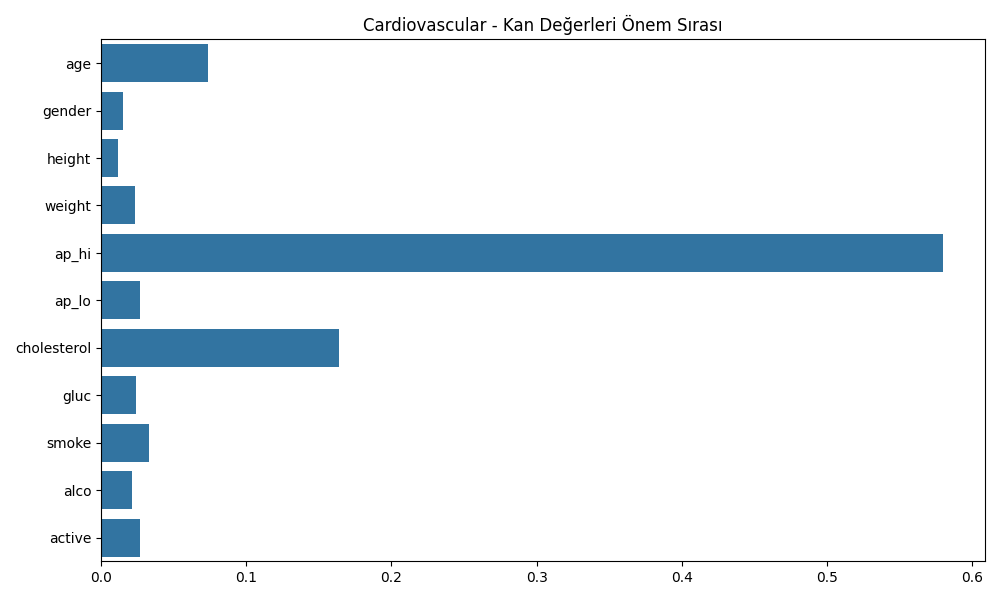</td>
    </tr>
    <tr>
      <td align="center"><b>Chronic Kidney Disease (CKD)</b></td>
      <td align="center"><b>Liver Disease Feature Importance</b></td>
    </tr>
    <tr>
      <td>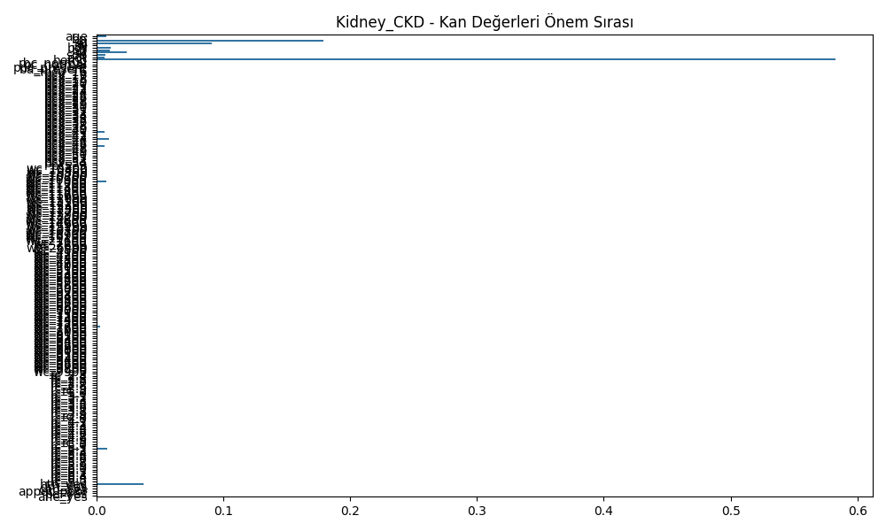</td>
      <td>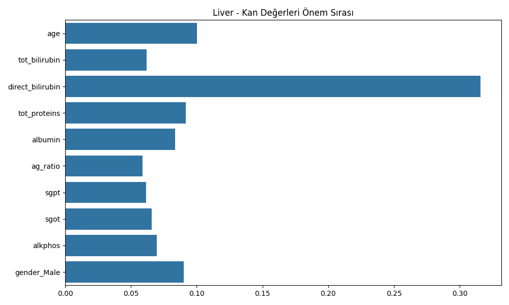</td>
    </tr>
  </table>
  <p><i>Figure 4: Key Feature Importance Attributions for Tabular Medical Models</i></p>
</div>

- **Anemia Classifier (9 Classes):** Analyzes HGB, MCHC, and MCH to differentiate between Iron Deficiency, Macrocytic, Normocytic, Hypochromic, and Thrombocytopenic conditions (`anemia_feature_importance.png`).

---

## 🔍 Explainable AI (XAI)

For AI to be viable in healthcare, decisions must be interpretable. This platform implements a two-pronged attribution strategy:

### 1. Visual Attribution (Grad-CAM++)
Highlights the exact pixel regions driving the model's classification:
- Gradients computed from `layer4[-1]` in ResNet-50 models.
- Dense feature activations tracked from `backbone.denseblock4` in DenseNet-121.
- Noise reduced using `aug_smooth=True` and `eigen_smooth=True`.

<div align="center">
  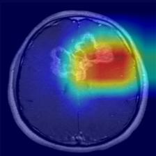
  <p><i>Figure 5: Grad-CAM++ Heatmap Overlay for Detected Meningioma Tumor on Brain MRI (Confidence: 97.5%)</i></p>
</div>

### 2. Numerical Attribution (Feature Importance & Flags)
Instead of returning a blunt prediction probability, the system surfaces:
- The **top 4 influential laboratory biomarkers** with percentage contributions.
- Automatic **High/Low flags** extracted from the patient's specific lab reference range.

---

## ⚙️ Core-Backend Architecture (Spring Boot & PostgreSQL)

The operational backbone is built on **Spring Boot 4.0.3** and **Java 21**:

- **Authentication & Security:** Clinically focused; single role `DOCTOR`. Protected via Spring Security and `jjwt 0.12` Bearer tokens.
- **Transaction Safety:** Database operations wrapped in `@Transactional` blocks. Failures during AI consultation trigger an automatic rollback to preserve medical record integrity.
- **PostgreSQL JSONB Support:** Native JSONB columns store literature citations (`citedSources`) and biomarker weights (`featureImportance`) without schema distortion.
- **Strict DTO Contracts:** Strict Java `record` types with `jakarta.validation` annotations ensure type safety across API boundaries.

---

## 💻 Frontend Architecture (React 19 & Tailwind CSS v4)

Designed with modern web standards for clinical usability:

- **React 19 & React Compiler:** Leverages compiler-driven memoization (`babel-plugin-react-compiler`) without manual `useMemo` clutter.
- **Tailwind CSS v4:** Modern `@theme` token system tailored for high-contrast clinical dashboards.
- **3-Panel Consultation Workspace:**
  - **Left Panel:** Demographics, medical history, allergies, and active medications.
  - **Center Panel:** Consultation dialogue, AI diagnostic reports, and clickable `[Ref-N]` citation badges.
  - **Right Panel:** Medical image viewer, Grad-CAM++ heatmap toggle, lab parameters, and physician RLHF feedback buttons.

---

## 🚀 Setup & Execution Guide

Follow these steps to run the complete environment locally.

### Prerequisites
- **Python:** `3.13` (or `uv` package manager)
- **Java:** `OpenJDK 21`
- **Node.js:** `v20+` & `npm`
- **Docker:** Docker Desktop for PostgreSQL

### 1. Start PostgreSQL
```bash
cd core-backend
docker compose up -d
```

### 2. Configure & Start Python AI Service
```bash
# In the repository root:
uv sync
# or
pip install -r requirements.txt

# Create .env in the repository root:
# PINECONE_API_KEY=your_key
# PINECONE_INDEX_NAME=medical-rag-system
# OPENAI_API_KEY=your_key
# TAVILY_API_KEY=your_key

# Run corpus embedding pipeline (once):
python -m src.scripts.embedding_pipeline

# Start FastAPI server (Port: 8000)
python -m src.api.main
```

### 3. Start Core-Backend Service
```bash
cd core-backend
./mvnw.cmd spring-boot:run
```
*(On initial launch, `DatabaseSeeder` will automatically populate medical dictionary seeds).*

### 4. Start Frontend
```bash
cd frontend
npm install
npm run dev
```
Access the application at `http://localhost:5173`.

---

## 📈 Engineering Insights & Future Work

As a graduating software engineer, key technical lessons and planned enhancements include:

1. **Multimodal Superstep Synchronization:** Deep learning pipelines and text loaders run at different latencies. Implementing explicit synchronizer nodes (`image_sync`) in LangGraph resolved race conditions and double-invocation bugs.
2. **Clinical Safety over Raw Accuracy:** In clinical informatics, minimizing False Negatives is paramount. Calibrating the Chest X-Ray Gatekeeper to `Max F2` (%98.61 Recall) demonstrates a deliberate choice to prioritize patient safety over precision.
3. **Identified Technical Debt:**
   - Incorporating the existing Thyroid model (`Thyroid_expert_model.joblib`) into the dynamic lab registry.
   - Decoupling the frontend API base URL into standard `VITE_API_URL` configuration.
   - Offloading heavy Grad-CAM rendering to an asynchronous queue (e.g., Celery/RabbitMQ).

---

## 👨‍💻 Author & License

- **Developer / Researcher:** Oğulcan Oğul  
- **Project Type:** Undergraduate Capstone / Thesis Project  
- **Contact:** [GitHub Profile](https://github.com/ogulcanogul1)

*Disclaimer: This system is developed solely for academic research and clinical decision support evaluation. It does not replace professional medical judgment and is intended as an assistive secondary opinion tool for qualified healthcare providers.*
