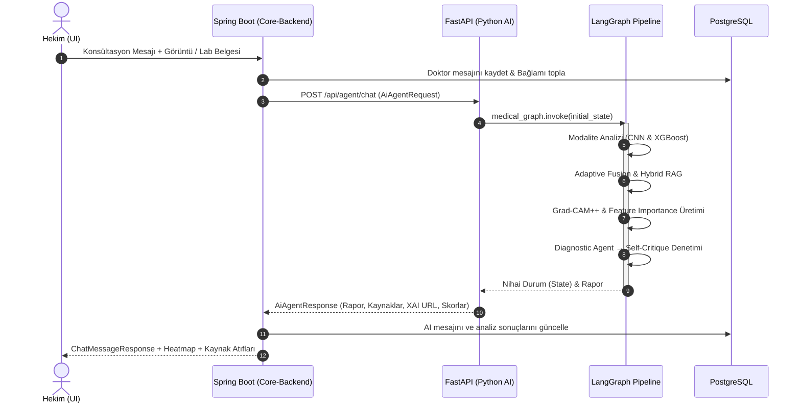
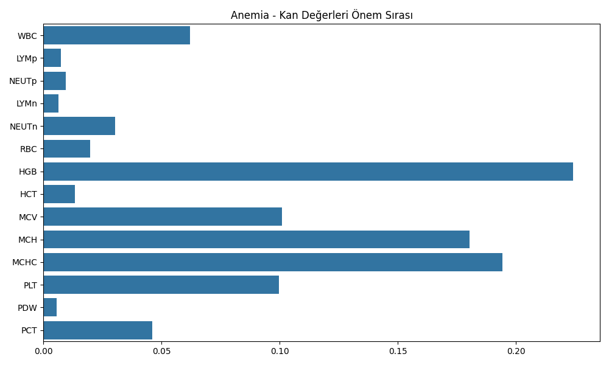

<div align="center">

# 🏥 Multimodal Klinik Karar Destek Sistemi (CDSS)
### Çok Modlu Derin Öğrenme, Gelişmiş Hibrit RAG ve Ajanik (Agentic) İş Akışlı Klinik Karar Destek Platformu

<p align="center">
  <b>Lisans Bitirme Tezi Projesi (Capstone Project)</b><br>
  <i>Tıbbi Görüntüleme • Sayısal Laboratuvar Verileri • Klinik Anamnez • Kanıta Dayalı Gelişmiş Hibrit RAG • Açıklanabilir Yapay Zeka (XAI)</i>
</p>

<p align="center">
  <a href="README.md"><b>🇹🇷 Türkçe</b></a> •
  <a href="README.en.md"><b>🇬🇧 English</b></a>
</p>

---

<!-- Badges -->


</div>

---

## 📌 İçindekiler
- [Proje Özeti ve Akademik Motivasyon](#-proje-özeti-ve-akademik-motivasyon)
- [Temel Mimari ve Servis Dağılımı](#-temel-mimari-ve-servis-dağılımı)
- [Python AI Servisi & LangGraph Ajanik Akışı](#-python-ai-servisi--langgraph-ajanik-akışı)
  - [LangGraph İş Akış Şeması](#langgraph-iş-akış-şeması)
  - [Uçtan Uca Sıra Diyagramı](#uçtan-uca-sıra-diyagramı)
- [Gelişmiş RAG Mimarisi ve Retrieval Kalite Mühendisliği (Best Practices)](#-gelişmiş-rag-mimarisi-ve-retrieval-kalite-mühendisliği-best-practices)
  - [1. Klinik Belge Arındırma ve Akıllı Ön İşleme (Ingestion Pipeline)](#1-klinik-belge-arındırma-ve-akıllı-ön-işleme-ingestion-pipeline)
  - [2. İki Kademeli Huni: Dense + Sparse Hibrit Arama & RRF](#2-iki-kademeli-huni-dense--sparse-hibrit-arama--rrf)
  - [3. Cross-Encoder ile Yeniden Sıralama (Reranking)](#3-cross-encoder-ile-yeniden-sıralama-reranking)
  - [4. Canlı ve Filtreli Tıbbi Web Taraması (Parallel Live Retrieval)](#4-canlı-ve-filtreli-tıbbi-web-taraması-parallel-live-retrieval)
  - [5. Düzeltici RAG (Corrective RAG - CRAG) ve Ajanik Öz-Denetim Döngüsü](#5-düzeltici-rag-corrective-rag---crag-ve-ajanik-öz-denetim-döngüsü)
- [Derin Öğrenme ve Makine Öğrenimi Modelleri](#-derin-öğrenme-ve-makine-öğrenimi-modelleri)
  - [CDSS Modalite Router (ResNet-18)](#1-cdss-modalite-router-resnet-18)
  - [Akciğer Röntgeni Hiyerarşik Modeli (DenseNet-121)](#2-akciğer-röntgeni-hiyerarşik-modeli-densenet-121)
  - [Beyin MR ve Göz Analiz Modelleri (ResNet-50)](#3-beyin-mr-ve-göz-analiz-modelleri-resnet-50)
  - [Laboratuvar Analiz Modelleri (XGBoost)](#4-laboratuvar-analiz-modelleri-xgboost)
- [Açıklanabilir Yapay Zeka (XAI)](#-açıklanabilir-yapay-zeka-xai)
- [Core-Backend Mimarisi (Spring Boot & PostgreSQL)](#-core-backend-mimarisi-spring-boot--postgresql)
- [Frontend Mimarisi (React 19 & Tailwind CSS v4)](#-frontend-mimarisi-react-19--tailwind-css-v4)
- [Kurulum ve Çalıştırma Kılavuzu](#-kurulum-ve-çalıştırma-kılavuzu)
- [Mühendislik Çıkarımları ve Gelecek Çalışmalar](#-mühendislik-çıkarımları-ve-gelecek-çalışmalar)
- [Yazar ve Lisans](#-yazar-ve-lisans)

---

## 🔬 Proje Özeti ve Akademik Motivasyon

Klinik tıpta teşhis süreci hiçbir zaman izole bir veriye dayanmaz. Bir hekim; hastanın şikayetini ve tıbbi geçmişini dinler, biyokimyasal kan ve idrar testlerini inceler, radyolojik görüntüleri değerlendirir ve bu verileri uluslararası kabul görmüş klinik kılavuzlar ışığında sentezler.

Günümüz yapay zeka çözümlerinin büyük kısmı ya yalnızca görüntü sınıflandıran **tekil modellerle** sınırlı kalmakta ya da tıbbi doğrulanabilirliği zayıf **kara kutu LLM yaklaşımlarına** dayanmaktadır. Bu sistemlerde karşılaşılan en büyük handikaplar:
1. **Halüsinasyon Riski:** Saf LLM'lerin klinik gerçeklikten kopuk veya hatalı tedavi protokolleri önerebilmesi.
2. **Modaliteler Arası Uyuşmazlık:** Kan tahlili ile radyolojik bulgunun çeliştiği durumlarda deterministik bir mutabakat mekanizmasının olmaması.
3. **Açıklanabilirlik Eksikliği:** Modelin lezyonu nerede gördüğünü (görsel kanıt) veya risk skorunu hangi biyobelirteç nedeniyle artırdığını (sayısal kanıt) hekime gösterememesi.
4. **Zayıf Bilgi Getirme (Retrieval Failure):** Standart RAG sistemlerinin nadir tıbbi kısaltmaları kaçırması, PDF gürültülerini (içindekiler, sayfa numaraları) bağlama dahil etmesi ve klinik kanıt kalitesini denetlememesi.

Bu lisans tezi çalışmasında; hekimin yerine karar veren değil, **hekimin karar sürecini kanıta dayalı ve açıklanabilir şekilde destekleyen çok modlu bir Klinik Karar Destek Sistemi (CDSS)** geliştirilmiştir. 

> [!NOTE]  
> **Projenin Temel Yaklaşımı:** Sistem; **PyTorch tabanlı derin öğrenme modellerini**, **XGBoost tabular modellerini**, **gelişmiş çift akışlı hibrit literatür taramasını (Pinecone Dense + BM25 Sparse + BGE Cross-Encoder Reranker + Canlı Hakemli Web Araştırması)** ve **LangGraph durum makinesini (StateGraph)** tek bir çatı altında birleştirir. Teşhis süreci, halüsinasyonu denetleyen **Self-Critique** ve modalite çelişkilerini çözen **Conflict Resolver** ajan döngüleri ile güvence altına alınmıştır.

---

## 🏗️ Temel Mimari ve Servis Dağılımı

Sistem, ayrık sorumluluk ilkesine (Separation of Concerns) uygun olarak **3 katmanlı dağıtık mikroservis mimarisi** üzerinde kurgulanmıştır:

```
┌─────────────────────────────────────────────────────────────────────────────┐
│                            FRONTEND (React 19 + Vite)                       │
│      Doktor Konsültasyon Çalışma Alanı • Dinamik Paneller • Canlı Chat      │
└──────────────────────────────────────┬──────────────────────────────────────┘
                                       │ HTTP REST / JWT Bearer (Port 5173 ↔ 8080)
                                       ▼
┌─────────────────────────────────────────────────────────────────────────────┐
│                         CORE-BACKEND (Spring Boot 4 + Java 21)              │
│    İş Mantığı • Kimlik Doğrulama • Veri Güvenliği • PostgreSQL (JSONB)      │
└──────────────────────────────────────┬──────────────────────────────────────┘
                                       │ HTTP POST /api/agent/chat (Port 8080 ↔ 8000)
                                       ▼
┌─────────────────────────────────────────────────────────────────────────────┐
│                          PYTHON AI SERVİSİ (FastAPI + LangGraph)            │
│   Multimodal Giriş • CNN & XGBoost • Gelişmiş RAG • XAI • Ajanik Muhakeme   │
└─────────────────────────────────────────────────────────────────────────────┘
```

### Katmanlar ve Sorumluluklar

| Katman | Teknoloji | Port | Temel Sorumluluk |
|---|---|---|---|
| **Frontend** | React 19, Tailwind CSS v4, Lucide | `5173` | Hekim çalışma alanı; dinamik hasta profili, görsel & doküman analiz panelleri, tıklanabilir kanıt kartları ve RLHF doktor geri bildirim arayüzü. |
| **Core-Backend** | Spring Boot 4.0.3, Java 21, Hibernate 6 | `8080` | Domain modelleri (Doktor, Hasta, Konsültasyon), Spring Security JWT doğrulama, PostgreSQL JSONB veri kalıcılığı ve AI orkestrasyonu. |
| **Python AI** | FastAPI, LangGraph, PyTorch, XGBoost | `8000` | Multimodal veri işleme, çift akışlı hibrit RAG, Grad-CAM++ üretimi, LangGraph durum yönlendirmesi. |
| **Veritabanı** | PostgreSQL 15 (Docker) | `5432` | İlişkisel tablolar, tahlil sonuçları, model tahminleri ve JSONB formatında saklanan literatür atıfları (citations). |

---

## 🧠 Python AI Servisi & LangGraph Ajanik Akışı

Sistemin karar motoru, LangGraph kütüphanesi üzerinde deterministik bir **Durum Makinesi (StateGraph)** olarak inşa edilmiştir. Akış, girdi türüne göre dinamik olarak dallanır, superstep senkronizasyonu sağlar ve döngüsel düzeltme adımlarıyla güvenilir sonuç üretir.

### LangGraph İş Akış Şeması

Aşağıdaki görsel, derlenen LangGraph durum makinesinin (`StateGraph`) gerçek çalışma topolojisini göstermektedir:

<div align="center">
  
  <p><i>Şekil 1: LangGraph tabanlı Multimodal Ajanik Durum Makinesi Akış Diyagramı</i></p>
</div>

### Adım Adım İşlem Akışı:

1. **Parser & Dynamic Router (Giriş Yönlendirici):** 
   Gelen hasta mesajını, yüklenen medikal görüntüyü ve/veya laboratuvar PDF dokümanını inceler. Verisi olmayan kolları çalıştırmayarak kaynak tüketimini optimize eder.
2. **Görsel Algılama Hattı (Visual Stream):**
   - **CNN Control (Gatekeeper):** Görselin tıbbi geçerliliğini ve modalitesini (`BRAIN`, `LUNG`, `EYE`) kontrol eder.
   - **Image Analyzer:** İlgili derin öğrenme uzman modelini (ResNet-50 veya DenseNet-121) tetikler.
   - **Image Sync:** Görüntü ve laboratuvar kollarının yürütme adımı (superstep) sayısını eşitleyen tampon düğümdür. Böylece `Adaptive Fusion` düğümünün zamansız çift tetiklenmesi önlenir.
3. **Laboratuvar Algılama Hattı (Lab Stream):**
   - **PDF Extract:** PyMuPDF ile dijital laboratuvar raporundan ham metni ayıklar.
   - **MLP Control:** LLM destekli tahlil sınıflandırıcı; dokümandaki biyokimyasal parametreleri yapısal formata (`LabReport`) çevirir ve hayati tahlil (key features) bütünlüğünü doğrular.
   - **Lab Analyzer:** İlgili hastalık için eğitilmiş XGBoost uzman modelini çalıştırır ve tahlil referans aralığı anomalilerini (High/Low) filtreler.
4. **Adaptive Fusion (Adaptif Füzyon Düğümü):**
   Farklı modalitelerden gelen bulguları (hasta anamnezi, yaş, cinsiyet, şikayet, kronik hastalıklar + CNN görsel tahminleri + XGBoost laboratuvar olasılıkları + referans dışı anomaliler) bir araya getirerek dinamik klinik bağlamı oluşturur.
5. **Dual-Stream Hybrid RAG (Gelişmiş Çift Akışlı Araştırma):**
   - **Query Optimizer:** Tıbbi NLP genişletmesi ile hekim sorusunu hastanın bulgularıyla zenginleştirir.
   - **Hybrid Search & Web Research:** Yerel vektör/anahtar kelime tabanı ile canlı medikal literatürü paralel olarak tarar.
   - **Knowledge Synthesis:** İki akıştan gelen bilgileri birleştirir ve her bilgi parçacığına doğrulanabilir kaynak kimliği (`[Ref-N]`) atar.
   - **Retrieval Grader:** Getirilen dökümanların klinik soruyla örtüşme kalitesini puanlar. Eşik değerin altındaysa sorguyu dönüştürüp yeniden dener (*Maksimum 2 retry*).
6. **XAI Generator & Diagnostic Agent (Başhekim Ajanı):**
   Görsel bulgular için **Grad-CAM++** ısı haritası ve laboratuvar için **Feature Importance** çıktısı hazırlanır. Başhekim LLM'i sentezlenen veriler ve tıbbi kanıtlar eşliğinde konsültasyon raporunu oluşturur.
7. **Self-Critique & Conflict Resolver (Öz-Denetim Döngüsü):**
   Oluşturulan rapor, multimodal bulgularla çelişki veya halüsinasyon riski açısından taranır. Tutarsızlık varsa `Conflict Resolver` devreye girerek teşhis ajanını revizyona yönlendirir (*Maksimum 2 retry limitli emniyet supabı*).

### Uçtan Uca Sıra Diyagramı



---

## 📚 Gelişmiş RAG Mimarisi ve Retrieval Kalite Mühendisliği (Best Practices)

Sıradan bir RAG pipeline'ı, medikal alanda yetersiz kalır; çünkü tıp metinleri karmaşık kısaltmalar, sayısal eşikler ve spesifik ilaç isimleri içerir. Bu projede literatür getirme (retrieval) kalitesini maksimize etmek adına sektörde kabul görmüş **ileri düzey RAG best practice'leri** uygulanmıştır:

```
┌─────────────────────────────────────────────────────────────────────────────────────────────┐
│                            1. DUAL SEARCH GENERATION (Query Optimizer)                      │
│      Girdi: Doktor Mesajı + Hastanın Klinik Anomalileri (örn: Pnömoni + Yüksek Glukoz)      │
└──────────────────────────────┬──────────────────────────────────────────────┬───────────────┘
                               │                                              │
                [Dense + Sparse Local Query]                   [3x Parallel 2026 Web Queries]
                               ▼                                              ▼
┌─────────────────────────────────────────────────────────────┐┌──────────────────────────────┐
│                  2. YEREL HİBRİT ARAMA                      ││   3. CANLI MEDİKAL WEB       │
│  ┌───────────────────────┐   ┌───────────────────────────┐  ││   (ThreadPoolExecutor)       │
│  │ Pinecone Dense Vector │   │ BM25Okapi Sparse Keyword  │  ││   PubMed / NIH, Mayo Clinic, │
│  │ (MiniLM-L6-v2) Top 30 │   │ (Sanitized Token) Top 30  │  ││   The Lancet, Nature Med     │
│  └───────────┬───────────┘   └─────────────┬─────────────┘  │└──────────────┬───────────────┘
│              │                             │                │               │
│              └──────────────┬──────────────┘                │               │
│                             ▼                               │               │
│        Reciprocal Rank Fusion (RRF, k=60) → Top 10          │               │
│                             ▼                               │               │
│    BAAI/bge-reranker-v2-m3 Cross-Encoder → Top 5 Aday       │               │
└─────────────────────────────┬───────────────────────────────┘               │
                              │                                               │
                              └───────────────────────┬───────────────────────┘
                                                      ▼
┌─────────────────────────────────────────────────────────────────────────────────────────────┐
│                       4. KNOWLEDGE SYNTHESIS & ATIF ENJEKSİYONU                             │
│                  Kaynak Eşleme • [[SOURCE ID: Ref-N]] Enjeksiyonu                           │
└─────────────────────────────────────────────┬───────────────────────────────────────────────┘
                                              ▼
┌─────────────────────────────────────────────────────────────────────────────────────────────┐
│                       5. CORRECTIVE RAG (Retrieval Quality Grader)                          │
│               Klinik Uygunluk Puanlaması (Binary Yes/No) • Retry (Max 2)                    │
└─────────────────────────────────────────────────────────────────────────────────────────────┘
```

### 1. Klinik Belge Arındırma ve Akıllı Ön İşleme (Ingestion Pipeline)
- **Geometrik Bounding Box ve Marjin Kırpma:** PyMuPDF (`fitz`) ile sayfalar blok koordinatlarına göre taranır. Sayfa yüksekliğinin üst `%6`'sı (running header), alt `%8`'i (sayfa numaraları, footer) ve kenar boşlukları (`%5` marjin) geometrik olarak kırpılarak şablon artıkları tamamen elenir.
- **TOC & Kaynakça Sayfası Filtreleme:** Sayfa başlıklarında *"table of contents"*, *"index"*, *"references"*, *"bibliography"* anahtar kelimeleri tespit edildiğinde bu sayfalar vektör veritabanına sokulmadan doğrudan atlanır.
- **De-hyphenation (Satır Sonu Tire Temizliği):** Satır sonundaki tirelemeler (`re.sub(r'-\s+', '', text)`) birleştirilerek *"hyper- tension"* gibi kritik medikal terimlerin parçalanması önlenir; anlamsal embedding doğruluğu korunur.
- **Küratörlü Klinik Kütüphane (Page Whitelisting):** Kitapların tamamı yerine yalnızca hakemli kılavuz bölümleri indekslenmiştir:
  - *ADA Standards of Care 2026 (Diyabet)*
  - *KDIGO 2024 Guidelines (Böbrek)*
  - *ESC 2024 Guidelines (Kardiyovasküler)*
  - *GINA Summary Guide 2024 (Astım)*
  - *NICE Guidelines (Anemi & KBH)*
  - *Oxford Handbook of Clinical Medicine & Harrison's Manual of Medicine*
- **Kelime Sınırına Duyarlı Akıllı Parçalama (Boundary-Aware Chunking):** `FixedSizeSplitter`, metni rastgele karakterden kesmek yerine geriye doğru son boşluk karakterini (`rfind(' ')`) tespit eder. Tıbbi cümle ve terim bütünlüğü korunur; `chunk_overlap` ile bağlam kopmaları engellenir.

---

### 2. İki Kademeli Huni: Dense + Sparse Hibrit Arama & RRF
- **Çift Temsil (Dense + Sparse):**
  - **Dense (Anlamsal):** `sentence-transformers/all-MiniLM-L6-v2` ile 384 boyutlu vektör uzayında anlamsal benzerlik.
  - **Sparse (Anahtar Kelime):** Tıbbi kısaltmalar, dozajlar ve özel parametreler için noktalama işaretlerinden arındırılmış `BM25Okapi` algoritması.
- **Reciprocal Rank Fusion (RRF, k=60):** İki farklı skorlama mekanizmasından gelen sıralamalar, standart literatür sabiti $k=60$ kullanılarak harmanlanır:
  $$\text{RRF Score}(d) = \sum_{m \in \{\text{Dense, Sparse}\}} \frac{1}{60 + \text{Rank}_m(d)}$$
- **Geniş Tarama (Broad Retrieval):** Pinecone'dan en iyi 30, BM25'ten en iyi 30 olmak üzere toplam 60 aday çekilir ve RRF ile ilk 10'a elenir.
- **Asenkron Batching & RAM Caching (Singleton):** Vektör indeksleme 150'lik asenkron batch'lerle (`async_req=True`) yapılır. Uygulama ayağa kalkarken BM25 indeksi diskteki pickle dosyasından, Cross-Encoder ve Embedding modelleri ise RAM'e yüklenerek ilk istek gecikmesi sıfırlanır.

---

### 3. Cross-Encoder ile Yeniden Sıralama (Reranking)
Bi-Encoder modelleri soru ile dokümanı ayrı ayrı vektörleştirirken, Cross-Encoder modeli `[Soru, Doküman]` çiftini tek bir metin gibi tam self-attention katmanından geçirir:
- **Model:** `BAAI/bge-reranker-v2-m3`
- RRF'ten çıkan 10 aday doküman, hekimin sorgusuna göre anlamsal alaka puanı (`reranker_score`) ile yeniden derecelendirilir ve yalnızca **en yüksek puanlı ilk 5 klinik doküman** seçilir.

---

### 4. Canlı ve Filtreli Tıbbi Web Taraması (Parallel Live Retrieval)
- **Güvenilir Alan Adı Beyaz Listesi (Domain Whitelisting):** Genel internet gürültüsünden kaçınmak için arama alanı yalnızca hakemli tıp portallarıyla sınırlandırılmıştır:
  - `ncbi.nlm.nih.gov` (PubMed / NIH)
  - `mayoclinic.org` & `clevelandclinic.org`
  - `hopkinsmedicine.org` (Johns Hopkins)
  - `thelancet.com` & `nature.com` (Nature Medicine)
  - `medscape.com`
- **ThreadPoolExecutor ile Paralel Çalışma:** Query Optimizer tarafından üretilen 3 farklı güncel kılavuz sorgusu, thread havuzu aracılığıyla **eşzamanlı (paralel)** taranır. Web arama gecikmesi 3 kat azaltılır.
- **Web Doküman Reranking:** İnternetten çekilen ham web metinleri de doğrudan LLM'e verilmez; BGE Cross-Encoder filtresinden geçirilerek yalnızca en alakalı 3 web kesiti alınır.

---

### 5. Düzeltici RAG (Corrective RAG - CRAG) ve Ajanik Öz-Denetim Döngüsü
- **Klinik Bağlam Genişletmeli Sorgu Optimizasyonu (Context-Aware Query Rewriting):** Hekim yalnızca *"Bu hastaya ne başlamalıyız?"* yazsa bile, `Query Optimizer` hastanın bağlamındaki anomalileri (örneğin *Diyabet + Pnömoni*) otomatik olarak sorguya enjekte eder.
- **Retrieval Grader (Sıkı Medikal İkili Puanlayıcı):** Sentezlenen dokümanlar Başhekim ajanına sunulmadan önce `retrieval_grader` düğümünde değerlendirilir. Her doküman klinik soruya yanıt verip vermediğine göre ikili (`binary_score: yes/no`) olarak denetlenir.
- **Self-Correction Retry Döngüsü:** Eğer getirilen dokümanlar kalite eşiğini geçemezse akış kesilmez; sorgu dönüştürülerek pipeline yeniden tetiklenir (*Maksimum 2 retry emniyet supabı*).
- **Kaynak Takibi ve Atıf Enjeksiyonu (Citation Injection):** `Knowledge Synthesis` aşamasında her dokümana `[[SOURCE ID: Ref-N]]` etiketi gömülür. LLM yanıtında her klinik iddiayı bu kaynak kimlikleriyle atıflamak zorundadır; böylece hekim UI üzerinde tıklanabilir kanıt kartlarına erişir.

---

## 🤖 Derin Öğrenme ve Makine Öğrenimi Modelleri

Sistem bünyesinde kullanılan modeller, genel geçer hazır yapay zeka servisleri yerine, açık kaynak medikal veri setleri üzerinde özel olarak eğitilmiş, hiperparametreleri optimize edilmiş ve klinik eşik değerleri belirlenmiş modellerdir.

### 1. CDSS Modalite Router (ResNet-18)
Sisteme yüklenen görüntünün hangi organ sistemine ait olduğunu belirleyen yerel sınıflandırıcıdır:
- **Mimari:** PyTorch ResNet-18 (Transfer Learning + Dropout 0.3)
- **Sınıflar:** `BRAIN` (Beyin), `LUNG` (Akciğer), `EYE` (Göz), `OTHER` (Diğer)
- **Sonuç:** Dengeli veri dağılımında %96'nın üzerinde doğruluk.

<div align="center">
  <table>
    <tr>
      <td align="center"><b>Karışıklık Matrisi (Confusion Matrix)</b></td>
      <td align="center"><b>Eğitim & Doğrulama Metrikleri</b></td>
    </tr>
    <tr>
      <td></td>
      <td></td>
    </tr>
  </table>
  <p><i>Şekil 2: CDSS Modalite Yönlendirici Modeline Ait Performans Grafikleri</i></p>
</div>

---

### 2. Akciğer Röntgeni Hiyerarşik Modeli (DenseNet-121)
Akciğer grafisi analizinde yanlış negatif (hasta vakayı sağlıklı olarak kaçırma) riskini asgariye indirmek adına **2 kademeli mimari** benimsenmiştir:

#### A) Gatekeeper (Kapı Bekçisi - İkili Tarama)
- **Model:** DenseNet-121 (Tek logit çıktı)
- **Strateji:** `Max F2` ve `Constrained Recall (>=0.94)` optimizasyonu.
- **Klinik Amaç:** Hekimin önüne gelecek potansiyel patolojileri kaçırmamak.

```
=== GATEKEEPER TEST SONUÇLARI ===
Strateji: Max F2 (Recall Ağırlıklı)
Eşik (Threshold)        : 0.090190
Hasta Sınıfı Recall     : %98.61 (15,975 / 16,201 hasta vaka başarıyla yakalandı)
Hasta Sınıfı Precision  : %73.16
F2 Skoru                : 0.8399
```

#### B) Dual-Head Multi-Label Uzman Model
Gatekeeper aşamasını geçen görüntüler, **142,279 eğitim görüntüsü** ile eğitilmiş ve TorchXRayVision omurgasını kullanan çift başlı DenseNet-121 modeline aktarılır:
- **Head A (Stabil Sınıflar):** Effüzyon, Ödem, Kardiyomegali
- **Head B (Gürültülü Sınıflar):** Atelektazi, Konsolidasyon, Pnömoni, Pnömotoraks
- **Eşikleme Stratejisi:** Her patoloji için bağımsız `Max F1` eşik kalibrasyonu.

<div align="center">
  <table>
    <tr>
      <td align="center"><b>Gatekeeper Eğitim Metrikleri</b></td>
      <td align="center"><b>Çoklu Etiket Eğitim & Doğrulama Eğrileri</b></td>
    </tr>
    <tr>
      <td></td>
      <td></td>
    </tr>
  </table>
  <p><i>Şekil 3: Akciğer Röntgeni Modellerine Ait Eğitim Metrikleri (Epoch 17 & Epoch 20)</i></p>
</div>

| Patoloji | Optimal Eşik (Threshold) | F1 Skoru | Precision | Recall |
|---|---|---|---|---|
| **Effusion (Plevral Sıvı)** | `0.5286` | **0.9496** | 0.9405 | 0.9588 |
| **Edema (Akciğer Ödemi)** | `0.6893` | **0.9132** | 0.8814 | 0.9474 |
| **Cardiomegaly (Kalp Büyümesi)** | `0.8666` | **0.9303** | 0.9202 | 0.9405 |
| **Consolidation (Konsolidasyon)** | `0.8941` | **0.8865** | 0.8872 | 0.8859 |

---

### 3. Beyin MR ve Göz Analiz Modelleri (ResNet-50)

- **Beyin Tümörü Sınıflandırma (MR):**
  - **Sınıflar:** Glioma Tümörü, Menenjiyom Tümörü, Hipofiz Tümörü, Normal (Tümör Yok).
  - **Mimari:** ResNet-50 transfer learning (Dropout 0.5 + 4 sınıflı lineer başlık).
- **Göz Hastalıkları Taraması (Fundus):**
  - **Sınıflar:** Katarakt, Diyabetik Retinopati, Glokom, Normal.
  - **Doğrulama Doğruluğu:** **%94.00**, Diyabetik Retinopati F1: **1.00**, Katarakt F1: **0.96**.

---

### 4. Laboratuvar Analiz Modelleri (XGBoost)
Sayısal biyokimya ve hematoloji testleri, ilgili klinik parametreler üzerinde eğitilmiş güncel XGBoost sınıflandırıcıları ile değerlendirilir. Her model için zorunlu kılınan hayati değişkenler (`MANDATORY_FEATURES`) ve karar ağırlıkları belirlenmiştir:

<div align="center">
  <table>
    <tr>
      <td align="center"><b>Diyabet Modeli Karar Ağırlıkları</b></td>
      <td align="center"><b>Kardiyovasküler Risk Karar Ağırlıkları</b></td>
    </tr>
    <tr>
      <td></td>
      <td></td>
    </tr>
    <tr>
      <td align="center"><b>Kronik Böbrek Hastalığı (KBH)</b></td>
      <td align="center"><b>Karaciğer Hastalığı Belirteçleri</b></td>
    </tr>
    <tr>
      <td></td>
      <td></td>
    </tr>
    <tr>
      <td colspan="2" align="center"><b>Anemi Alt Tipleri (9 Sınıf) Özellik Ağırlıkları</b></td>
    </tr>
    <tr>
      <td colspan="2" align="center"></td>
    </tr>
  </table>
  <p><i>Şekil 4: Güncellenmiş XGBoost Laboratuvar Modellerine Ait Klinik Özellik Önem Sıralamaları (Feature Importance)</i></p>
</div>

- **Anemi Modeli (9 Sınıf):** Hemoglobin (HGB), MCHC ve MCH parametrelerine dayalı olarak Demir Eksikliği, Makrositik, Normositik, Hipokromik veya Trombositopeni alt tiplerini belirler.

---

## 🔍 Açıklanabilir Yapay Zeka (XAI)

Yapay zekanın klinik alanda kabul görmesinin ön şartı **kararın gerekçelendirilebilir olmasıdır**. Bu sistemde hekime iki yönlü açıklanabilirlik sunulur:

### 1. Görsel Açıklanabilirlik (Grad-CAM++)
Modelin bir patolojiyi tespit ederken görselin hangi piksellerine odaklandığı, gradyan ağırlıklı sınıf aktivasyon haritaları ile görselleştirilir:
- ResNet-50 modelleri için `layer4[-1]` katmanından gradyan alınır.
- DenseNet-121 multi-label modeli için `backbone.denseblock4` katmanı hedeflenir.
- Gürültüyü azaltmak için `aug_smooth=True` ve `eigen_smooth=True` filtreleri uygulanır.

<div align="center">
  
  <p><i>Şekil 5: Beyin MR Görüntüsünde Tespit Edilen Menenjiyom Tümörünün Grad-CAM++ Isı Haritası Örtüşümü (Güven: %97.5)</i></p>
</div>

### 2. Sayısal Açıklanabilirlik (Feature Importance & Reference Flags)
Laboratuvar tahlili incelendiğinde hekime sadece bir teşhis etiketi dönülmez:
- Karara en çok etki eden **ilk 4 biyobelirteç ve yüzde katkıları** sunulur.
- Raporun kendi referans aralığına göre yüksek (`HIGH`) veya düşük (`LOW`) olan değerler açıkça listelenir.

---

## ⚙️ Core-Backend Mimarisi (Spring Boot & PostgreSQL)

Sistemin operasyonel omurgasını oluşturan Core-Backend, **Spring Boot 4.0.3** ve **Java 21** ile geliştirilmiştir:

- **Rol ve Yetkilendirme:** Sistem klinik odaklıdır; tek rol `DOCTOR`'dur. Giriş ve kayıt işlemleri Spring Security ve `jjwt 0.12` tabanlı Bearer token ile korunur.
- **Veri Güvenliği ve Bütünlüğü:** Tüm servis çağrıları `@Transactional` sınırları içerisinde yürütülür. Python AI çağrısında beklenmeyen bir aksaklık olması durumunda doktor mesajı ve analiz durumu veri tutarlılığını korumak için rollback edilir.
- **JSONB Desteği:** PostgreSQL'in JSONB kabiliyeti sayesinde literatür atıfları (`citedSources`) ve model önem skorları (`featureImportance`) ilişkisel şemayı bozmadan yapısal ve sorgulanabilir olarak saklanır.
- **REST Sözleşmesi:** Frontend ile haberleşme DTO katmanında katı Java `record` tipleri ve `jakarta.validation` kuralları ile garanti altına alınmıştır.

---

## 💻 Frontend Mimarisi (React 19 & Tailwind CSS v4)

Hekim deneyimini optimize etmek adına modern web standartları benimsenmiştir:

- **React 19 & React Compiler:** Manuel bellek yönetimi (`useMemo`/`useCallback`) ihtiyacını ortadan kaldıran yeni nesil derleyici altyapısı.
- **Tailwind CSS v4:** `@theme` token sistemi ile modernize edilmiş, tıbbi arayüze uygun renk ve kontrast paleti.
- **Konsültasyon Çalışma Alanı (Workspace):**
  - **Sol Panel:** Hasta demografik verileri, kronik hastalıklar, alerjiler ve güncel ilaçlar.
  - **Orta Panel:** Gerçek zamanlı konsültasyon sohbeti, AI yanıt balonları ve tıklanabilir `[Ref-N]` tıbbi kaynak kartları.
  - **Sağ Panel:** Yüklenen radyoloji görüntüsü, Grad-CAM++ ısı haritası geçişi, laboratuvar tahlil parametreleri ve hekim RLHF onay/red butonları.

---

## 🚀 Kurulum ve Çalıştırma Kılavuzu

Projeyi yerel geliştirme ortamınızda çalıştırmak için aşağıdaki adımları sırasıyla takip edebilirsiniz.

### Ön Koşullar
- **Python:** `3.13` (veya `uv` paket yöneticisi)
- **Java:** `OpenJDK 21`
- **Node.js:** `v20+` & `npm`
- **Docker:** PostgreSQL konteyneri için Docker Desktop

### 1. PostgreSQL Veritabanını Başlatma
```bash
cd core-backend
docker compose up -d
```

### 2. Python AI Servisini Hazırlama ve Başlatma
```bash
# Proje kök dizininde:
uv sync
# veya
pip install -r requirements.txt

# .env dosyasını kök dizinde yapılandırın:
# PINECONE_API_KEY=your_key
# PINECONE_INDEX_NAME=medical-rag-system
# OPENAI_API_KEY=your_key
# TAVILY_API_KEY=your_key

# RAG bilgi korpusunu bir defaya mahsus indeksleyin:
python -m src.scripts.embedding_pipeline

# FastAPI servisini başlatın (Port: 8000)
python -m src.api.main
```

### 3. Core-Backend Servisini Başlatma
```bash
cd core-backend
./mvnw.cmd spring-boot:run
```
*(İlk açılışta `DatabaseSeeder` gerekli temel medikal sözlük verilerini otomatik olarak yükleyecektir).*

### 4. Frontend Uygulamasını Başlatma
```bash
cd frontend
npm install
npm run dev
```
Uygulama tarayıcınızda `http://localhost:5173` adresinde açılacaktır.

---

## 📈 Mühendislik Çıkarımları ve Gelecek Çalışmalar

Sektöre adım atacak bir mühendis perspektifiyle, bu projede elde edilen deneyimler ve geliştirilmeye açık teknik alanlar şunlardır:

1. **Çoklu Modalite Senkronizasyonu:** Farklı hızlarda ve adımlarda çalışan derin öğrenme kolları (CNN) ile metin madenciliği kollarının (PyMuPDF + LLM) LangGraph üzerinde tampon düğümler (`image_sync`) aracılığıyla senkronize edilmesi mimari kararlılığı ciddi ölçüde artırmıştır.
2. **Klinik Güvenlik Supabı:** Bir modelin yüksek doğruluğa sahip olması tek başına yetersizdir; tıp bilişiminde asıl başarı **yanlış negatif oranını düşürmektir**. Akciğer taramasında `Max F2` (%98.61 Recall) tercihinin yapılması bu bilincin sonucudur.
3. **Retrieval Kalite Mühendisliği:** Saf anlamsal vektör aramasının nadir tıbbi terminolojide tıkandığı gözlemlenmiş; BM25 ve Cross-Encoder (Reranker) hibrit mimarisinin getirdiği klinik alaka düzeyinin çıktıyı doğrudan iyileştirdiği kanıtlanmıştır.
4. **Planlanan Geliştirmeler (Technical Debt):**
   - Disk üzerinde hazır bulunan tiroit uzman modelinin (`Thyroid_expert_model.joblib`) tahlil işleme hattına dinamik olarak entegre edilmesi.
   - Frontend API adresinin harici ortam değişkenlerine (`VITE_API_URL`) tam taşınması.
   - Grad-CAM heatmap üretiminin görüntü yükleme anında asenkron kuyruk yapısına (Celery/RabbitMQ) devredilmesi.

---

## 👨‍💻 Yazar ve Lisans

- **Geliştirici / Araştırmacı:** Oğulcan Oğul  
- **Proje Türü:** Lisans Tezi / Bitirme Projesi (Undergraduate Thesis / Capstone Project)  
- **İletişim:** [GitHub Profili](https://github.com/ogulcanogul1)

*Bu proje akademik araştırma ve klinik karar destek mimarilerini inceleme amacıyla geliştirilmiştir. Doğrudan tıbbi teşhis koyma iddiası taşımaz; hekimin klinik kanaatini destekleyecek ikinci bir göz olarak tasarlanmıştır.*
